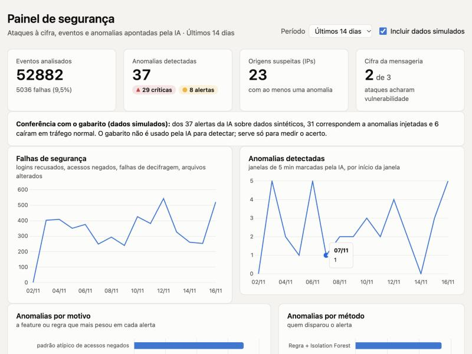

# Painel de segurança (dashboard)

Etapa **6. Dashboard** da arquitetura: gráficos de ataques e anomalias, em `/painel-seguranca/`. Lê só a tabela
`EventoSeguranca`, isto é, os eventos da camada Big Data, os alertas da IA ([IA_ANOMALIAS.md](IA_ANOMALIAS.md))
e os resumos dos ataques à cifra ([ATAQUES_CIFRA.md](ATAQUES_CIFRA.md)).

Código: `projeto/apps/painel.py` (dados), `apps/views_painel.py` (view), `apps/templates/painel_seguranca.html`,
`apps/static/js/painel_seguranca.js` e `apps/static/css/painel_seguranca.css`. Capturas de tela:
[`evidencias/08-painel-seguranca/`](../evidencias/08-painel-seguranca/).



## O que o painel mostra

| Bloco | Conteúdo | Pergunta que responde |
|---|---|---|
| Indicadores | eventos analisados e taxa de falha; anomalias (críticas e alertas); IPs suspeitos; quantos ataques acharam vulnerabilidade na cifra | Como está o sistema agora? |
| Conferência com o gabarito | dos alertas sobre dados simulados, quantos batem com uma anomalia injetada | A IA está acertando? (só aparece com dado sintético) |
| Falhas de segurança no tempo | logins recusados, acessos negados, falhas de decifragem, arquivos alterados, por dia (ou por hora no período de 24 h) | Houve pico de tentativas? |
| Anomalias no tempo | alertas da IA por dia | Quando aconteceram os incidentes? |
| Anomalias por motivo / por método | a feature ou regra que mais pesou; quem disparou (regra, Isolation Forest ou ambos) | Que tipo de ataque predomina? A IA pega o que as regras não pegam? |
| Ataques à cifra | último resultado de cada ataque (diferencial, força bruta, estatístico), com veredito e métricas | A cifra da mensageria é segura? |
| Anomalias recentes | as 25 últimas, com origem, severidade, motivo, pontuação e as features que mais se desviaram | O que investigar primeiro? |
| Eventos por tipo, origens com mais anomalias | volume por tipo de evento; ranking de IPs | Quem é o atacante mais ativo? |
| Dados em tabela | todos os números dos gráficos | Leitura sem gráfico (acessibilidade, relatório) |

Os filtros no topo escolhem o período (24 h, 7, 14 ou 30 dias, ou tudo) e se os dados simulados entram. Os
ataques à cifra não seguem o período, porque o veredito vale até alguém rodar os ataques de novo.

## Como usar

Dentro de `projeto/`:

```bash
python manage.py gerar_eventos_simulados --qtd 50000   # dados (ou use o sistema normalmente)
python manage.py detectar_anomalias                    # IA grava os alertas (precisa de requirements-ia.txt)
python manage.py rodar_ataques                         # resultados dos ataques à cifra
python manage.py createsuperuser                       # usuário da equipe (is_staff)
python manage.py runserver
```

Depois, abra `http://localhost:8000/painel-seguranca/` logado com o usuário da equipe.

## Decisões de projeto

**Acesso só para a equipe (`is_staff`).** O painel expõe IPs de origem, horários de ataque e as fraquezas da
cifra, informação útil para quem quer atacar. Visitante anônimo é levado ao login. Usuário logado sem permissão
recebe **403**, e a tentativa vira um evento `acesso_negado` com motivo `nao_staff`, que a própria IA analisa
depois. Há testes para os três casos.

**Sem HTML montado a partir de dado do banco.** O campo `usuario` é texto livre: numa falha de login, ele vem
do que o atacante digitou (pseudonimizado). Por isso:
- Os dados dos gráficos chegam ao navegador por `json_script`, que escapa `<`, `>` e `&`.
- O JavaScript fica num arquivo estático e preenche a tabela com `textContent`, nunca com `innerHTML`.
- O Chart.js desenha os rótulos em `<canvas>`, que não interpreta HTML.
- Nenhum `|safe` nem `mark_safe`. Há teste que grava `</script><script>alert(1)</script>` como usuário e
  confirma que a página não o devolve cru.

**Compatível com a CSP do projeto** (`apps/security_headers.py`). O Chart.js vem do jsdelivr, que já está em
`script-src`, com **Subresource Integrity** (`integrity="sha384-..."`): se o arquivo do CDN for adulterado, o
navegador não executa. O CSS é próprio, sem Bootstrap, porque `style-src` não libera o jsdelivr.

**Painel sem scikit-learn.** `painel.py` só consulta a tabela. O servidor web não precisa das dependências da
IA, então o deploy continua leve.

**Escolhas visuais.** Uma série por gráfico (o título nomeia, sem legenda). Falhas e anomalias ficam em
gráficos separados, e não em eixo duplo, porque têm escalas muito diferentes (centenas por dia contra poucas
unidades). Severidade sempre com ícone e texto (▲ Crítico, ● Alerta, ✓ Resistiu), nunca só com cor. Há modo
escuro, o layout funciona em celular e todos os gráficos têm uma tabela equivalente.

## Limitações

- Os números são recalculados a cada acesso. Para muitos milhões de eventos, o próximo passo seria guardar
  agregados prontos (por dia e por tipo) em vez de agregar na hora.
- A conferência com o gabarito só existe para dados sintéticos. Em produção não há gabarito, e a qualidade da
  IA teria de ser medida pela triagem humana dos alertas.
