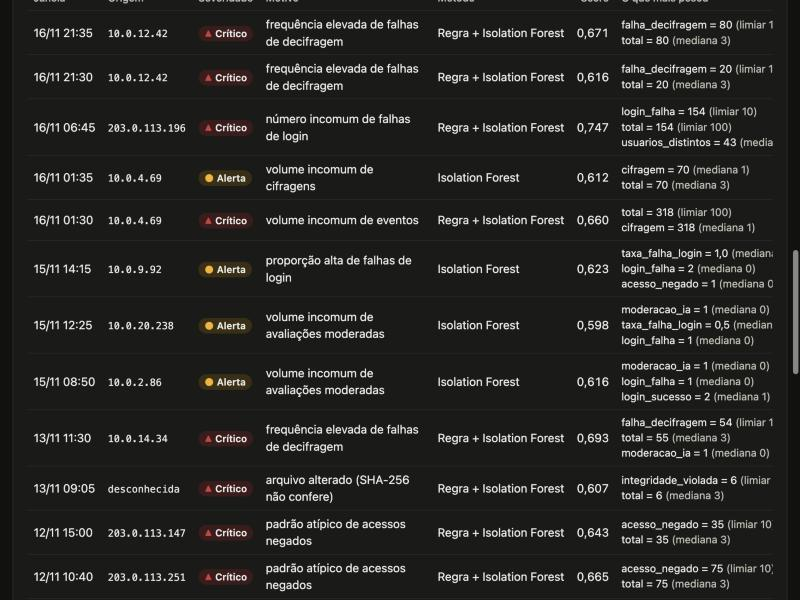

# Relatório final — Projeto 2: criptografia, ataques, Big Data e IA

> **Rascunho consolidado.** Junta o que cada parte entregou no repositório, com os números das evidências.
> A seção 3 (esteganografia) aguarda a entrega da Pessoa 3. Revisar antes de enviar.

## Arquitetura

```
1. Entrada        mensagem privada cliente → cafeteria
2. Criptografia   cifra própria (SPN + CBC, chave dinâmica)          — Pessoa 1
   ├─ Ataques     força bruta, diferencial, estatístico              — Pessoa 2
3. Esteganografia texto cifrado escondido em imagem (LSB)            — Pessoa 3 (pendente)
4. Big Data       tabela EventoSeguranca: todo evento de segurança   — Pessoa 4
5. IA             detecção de anomalias (regras + Isolation Forest)  — Pessoa 5
6. Dashboard      /painel-seguranca/ + este relatório                — Pessoa 6
```

Todas as camadas conversam pela tabela de eventos. A cifra registra cifragens e falhas de decifragem; o login,
o controle de acesso e a verificação de integridade registram tentativas e negações; os ataques registram um
resumo por execução; a IA lê tudo isso e grava os alertas; e o painel mostra o resultado.

| Parte | Responsável | Documento | Evidência |
|---|---|---|---|
| 1. Cifra | Luziane | `projeto/apps/mensageria_cripto.py` (docstring) | testes em `apps/test_eventos.py` |
| 2. Ataques | Maju | [ATAQUES_CIFRA.md](ATAQUES_CIFRA.md) | [`evidencias/05-ataques-cifra/`](../evidencias/05-ataques-cifra/) |
| 3. Esteganografia | Davi | — | — |
| 4. Big Data | Lisa | [BIG_DATA_EVENTOS.md](BIG_DATA_EVENTOS.md) | [`evidencias/06-big-data-eventos/`](../evidencias/06-big-data-eventos/) |
| 5. IA de anomalias | Paulo | [IA_ANOMALIAS.md](IA_ANOMALIAS.md) | [`evidencias/07-ia-anomalias/`](../evidencias/07-ia-anomalias/) |
| 6. Dashboard | Paulo | [PAINEL_SEGURANCA.md](PAINEL_SEGURANCA.md) | [`evidencias/08-painel-seguranca/`](../evidencias/08-painel-seguranca/) |

---

## 1. Criptografia: cifra própria da mensageria

**Algoritmo.** Rede de substituição-permutação (SPN) em blocos de 8 bytes, inspirada na estrutura do AES, de
forma simplificada:

- **Chave dinâmica:** `gerar_chave()` sorteia 8 bytes novos para cada mensagem. Nenhuma chave é fixa.
- **Rodadas (4):** XOR com a sub-chave da rodada → substituição byte a byte por uma S-box fixa (confusão) →
  permutação da ordem dos bytes no bloco (difusão).
- **Modo de operação:** encadeamento CBC com IV aleatório de 8 bytes. Cada bloco claro passa por XOR com o bloco
  cifrado anterior antes das rodadas.
- **Formato:** padding PKCS7; a saída é IV + blocos, em base64.

**Funcionamento no sistema.** O cliente envia uma mensagem privada à cafeteria. O texto é cifrado com uma chave
nova e gravado em `MensagemPrivada`, e o dono da cafeteria o lê decifrado na caixa de entrada. Cada cifragem e
cada decifragem vira um evento, sem texto nem chave. Uma decifragem que falha (chave errada, dado corrompido,
padding inválido) vira um evento `falha_decifragem`.

**Testes.** Ida e volta (`decifrar(cifrar(x)) == x`), chave errada gerando falha registrada, e ausência de
texto ou chave nos eventos (`apps/test_eventos.py`).

## 2. Ataques à cifra

| Pergunta | Resposta | Evidência |
|---|---|---|
| Tem efeito avalanche? | **Não** | Inverter 1 bit do texto muda **6,3%** dos bits do bloco (ideal: ~50%) e nunca mais de 1 byte em 8. A P-box só troca bytes de lugar, então a cifra se comporta como 8 cifras independentes de 1 byte. |
| Resiste à força bruta? | **Não** | Chave reduzida a 16 bits: quebrada em 11.481 tentativas (~1 s). Chave real de 64 bits: ~27,6 milhões de anos testando tudo em Python, mas o ataque **dividir para conquistar** recupera a chave completa em **~1 s** com 24 bytes de texto conhecido, porque cada byte cifrado depende de só 4 bytes da chave. |
| Resiste à análise estatística? | **Sim** | Texto cifrado com entropia de 7,999 bits/byte e qui-quadrado com p = 0,62 (indistinguível de uniforme), graças ao CBC com IV aleatório e à chave nova por mensagem. |
| É segura? | **Não** | Sem avalanche, chave recuperável, maleável (trocar "2 pessoas" por "9 pessoas" sem a chave) e sem autenticação. |

Problema mais grave na prática: **a chave de cada mensagem fica gravada na mesma linha do texto cifrado**
(`MensagemPrivada.chave`). Quem lê o banco decifra tudo sem atacar a cifra.

Detalhes, método e recomendações: [ATAQUES_CIFRA.md](ATAQUES_CIFRA.md).

## 3. Esteganografia (LSB)

*Pendente: entrega da Pessoa 3.* A camada de eventos já tem o tipo `esteganografia` reservado. Quando a parte
for integrada, cada operação de esconder ou extrair deve chamar
`registrar_evento('esteganografia', ..., detalhes={'bytes_escondidos': ..., 'psnr_db': ...})`, e o painel passa
a contá-la em "Eventos por tipo" sem nenhuma mudança.

Itens esperados para esta seção: algoritmo (substituição do bit menos significativo dos pixels), capacidade da
imagem, qualidade visual (PSNR) e um teste de extração do texto cifrado.

## 4. Big Data: tabela de eventos de segurança

**O que é.** Uma tabela única, `EventoSeguranca`, com uma linha por evento: data, tipo, categoria, severidade,
sucesso, usuário, IP, origem, duração e metadados em JSON. Tem índices por data, tipo, IP e usuário. Guarda **só
metadados**: texto de mensagem, chave e senha são descartados mesmo se passados por engano, e o e-mail digitado
numa falha de login é pseudonimizado (LGPD).

**Fontes.** Cifra, login (sucesso, falha, bloqueio por CAPTCHA), acesso negado (IDOR, não-empresário),
integridade de arquivos (SHA-256), moderação por IA, ataques simulados e os alertas da IA de anomalias. O
histórico de `logs/security.log` pode ser importado.

**Volume.** Um gerador sintético cria tráfego normal (com mais atividade em horário comercial) e injeta os cinco
tipos de anomalia citados no enunciado. Com 50 mil eventos, a geração leva ~9 s e a análise com exportação CSV,
~3 s.

**Processamento.** `analise_eventos.py` entrega resumos, séries temporais, rankings e as **features por janela**
(uma linha por IP e janela de 5 minutos), que são a entrada da IA.

## 5. IA de detecção de anomalias

**Algoritmo.** Detector híbrido, no mesmo desenho de um SIEM:

1. **Regras de assinatura:** limiares por janela de 5 min (≥ 10 falhas de login, ≥ 10 falhas de decifragem,
   ≥ 10 acessos negados, ≥ 100 eventos, qualquer arquivo alterado). Alta precisão, mas só pegam o que alguém
   previu.
2. **Isolation Forest** (scikit-learn, não supervisionado): aprende o comportamento normal a partir dos próprios
   dados, sem rótulos, e pontua cada janela de 0 a 1 pela facilidade com que ela é isolada das demais. Pega
   combinações que nenhuma regra descreve.

Cada alerta é gravado como evento `anomalia`, com severidade (`critico` para regra ou pontuação ≥ 0,70,
`alerta` para o resto), método, pontuação e as 3 features que mais se desviaram do normal, com o valor e a
mediana. Isso é o que torna o alerta explicável.

**Testes.** 17 testes automatizados, entre eles: regras sem o modelo; o modelo pegando uma combinação abaixo de
todos os limiares; reprodutibilidade; idempotência (rodar duas vezes não duplica); os alertas não contaminam a
próxima execução; e o controle de acesso ao painel.

**Resultados.** Avaliação contra o gabarito dos dados sintéticos. Calibração na semente 42; validação em 5
sementes novas, sem reajuste (média):

| Abordagem | Precisão | Recall | F1 |
|---|---|---|---|
| Só regras | 1,000 | 0,813 | 0,896 |
| Só Isolation Forest | 0,836 | 0,769 | 0,800 |
| **Híbrido** | **0,851** | **0,867** | **0,858** |

| Anomalia do enunciado | Detectado (híbrido) | Quem pegou melhor |
|---|---|---|
| Número incomum de tentativas de autenticação | 88% | Isolation Forest (88%) × regras (78%) |
| Comportamento incomum na geração de eventos | 76% | Isolation Forest (76%) × regras (61%) |
| Alterações inesperadas em arquivos | 100% | regras (100%) × Isolation Forest (37%) |
| Frequência elevada de falhas de descriptografia | 94% | empate |
| Padrões atípicos de acesso | 82% | empate |

O modelo ganha nas **bordas dos ataques**: quando uma rajada atravessa a fronteira entre janelas, sobra um
pedaço abaixo do limiar da regra que, ainda assim, é raro. As regras são indispensáveis para arquivo alterado,
um evento pequeno demais para parecer estatisticamente raro. O custo do híbrido são ~5 falsos positivos por
rodada de 50 mil eventos, todos de severidade `alerta`.

**Limitações.** Dados sintéticos com ataques conhecidos (o que favorece as regras); contaminação fixa (o modelo
sempre aponta ~3% das janelas ativas); fragmentos com menos de 3 eventos não são detectados. Detalhes:
[IA_ANOMALIAS.md](IA_ANOMALIAS.md).

## 6. Dashboard

`/painel-seguranca/`, restrito à equipe (`is_staff`). Mostra indicadores, falhas e anomalias no tempo, anomalias
por motivo e por método, o veredito de cada ataque à cifra, a tabela de anomalias recentes com a explicação de
cada uma, e o ranking de IPs suspeitos. Quem tenta abrir o painel sem permissão recebe 403, e a tentativa vira
evento. Os dados chegam ao navegador escapados (sem risco de XSS por dado do banco), o Chart.js é carregado com
Subresource Integrity e a página respeita a Content Security Policy do projeto. Detalhes:
[PAINEL_SEGURANCA.md](PAINEL_SEGURANCA.md).



---

## Conclusão

1. **A cifra própria cumpre os requisitos de construção, mas não é segura.** Tem chave dinâmica, XOR,
   substituição, permutação, blocos e encadeamento, e passa no teste estatístico. Mas a falta de mistura entre
   os bytes do bloco elimina o efeito avalanche e permite recuperar a chave em ~1 s com texto conhecido. Para
   dado real, a recomendação é AES-GCM ou Fernet, que o projeto já usa nas reservas, além de **não guardar a
   chave ao lado do texto cifrado**.
2. **Registrar eventos estruturados é o que torna a detecção possível.** Antes, os eventos eram linhas de texto
   num arquivo de log. Com a tabela, a mesma informação vira features por janela, séries temporais e alertas
   explicáveis.
3. **Regras e IA se complementam.** As regras dão precisão e explicação imediata para o ataque conhecido. O
   Isolation Forest aumenta o recall onde a regra é cega, sem nenhum limiar escrito à mão. O detector híbrido
   teve o melhor recall (0,867) com precisão de 0,851.
4. **Próximos passos.** Integrar a esteganografia ao fluxo de eventos; corrigir a cifra (mistura de bytes,
   chave de 128 bits, HMAC) e rodar os ataques de novo como critério de aceite; tirar a chave de
   `MensagemPrivada`; e agendar a IA para processar só as janelas novas.

## Como reproduzir tudo

Dentro de `projeto/`:

```bash
pip install -r requirements-ia.txt
python manage.py migrate
python manage.py gerar_eventos_simulados --qtd 50000 --seed 1
python manage.py rodar_ataques
python manage.py detectar_anomalias --avaliar
python manage.py test apps
python manage.py runserver            # painel em /painel-seguranca/ (usuário is_staff)
```
